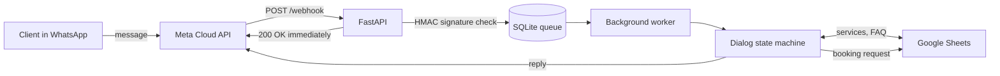

# WhatsApp Booking Bot


A bot that takes booking requests in WhatsApp 24/7 and writes them to a Google Sheet.
Built for a solo beauty practice where the owner handles both appointments and messaging.

**The client's key requirement:** her personal number had to keep working exactly as before. The
bot is connected through the WhatsApp Cloud API in **Coexistence** mode: the phone app and the bot
use the same number at the same time. If the owner replies to a client herself, the bot goes quiet
in that chat.

## How it works



- **The webhook acknowledges Meta immediately** and puts the message on a SQLite-backed queue.
  Google Sheets can take seconds to respond; if Meta waits too long it redelivers and eventually
  disables the webhook. The queue survives container restarts.
- **Idempotency**: `message_id` is the primary key, so a redelivered webhook never creates a
  second booking.
- **Retries with exponential backoff** (5 s → 15 s → 1 min → 5 min), so an hour-long Google outage
  doesn't hammer the API every second.
- **The dialog is a finite-state machine**: service → preferred time → name → confirmation. At any
  step the client can ask a question; the bot answers from the FAQ and keeps their place.
- **The owner manages content herself**: services, prices and FAQ answers live in the Google Sheet.
  No developer needed for edits.
- **Every incoming request is signature-checked** (`X-Hub-Signature-256`); forged messages are
  rejected.

## Stack

Python 3.12 · FastAPI · Pydantic v2 · httpx · WhatsApp Cloud API · Google Sheets API ·
SQLite (WAL) · Docker · Fly.io · pytest · GitHub Actions

## Layout

```
app/
  main.py          webhook, background worker, periodic cleanup
  conversation.py  dialog (finite-state machine)
  storage.py       SQLite: queue, sessions, human handoff
  whatsapp.py      Cloud API client + signature verification
  sheets.py        reading services/FAQ, appending bookings
  retry.py         retries with exponential backoff
  schemas.py       Meta webhook models
tests/             24 tests: dialog, queue, webhook
docs/INSTALL.md    step-by-step setup guide for a sysadmin (Russian)
```

## Running

```bash
cp .env.example .env          # Meta credentials and spreadsheet ID
mkdir secrets && cp ~/service-account.json secrets/
docker compose up -d --build
```

## Tests

```bash
pip install -r requirements-dev.txt
ruff check . && pytest -q
```

Tests never hit external services: WhatsApp and Google Sheets are replaced with fakes.

The bot talks to clients in Russian, so user-facing strings and code comments are in Russian.
